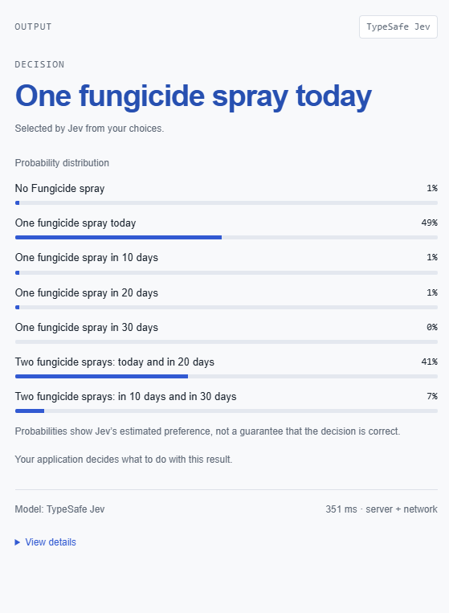
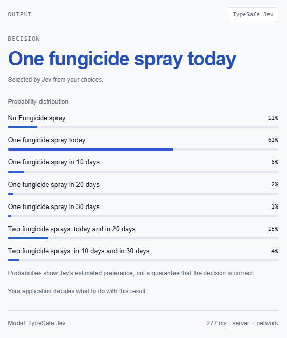
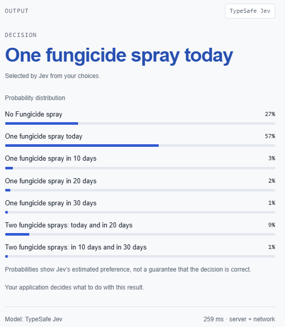
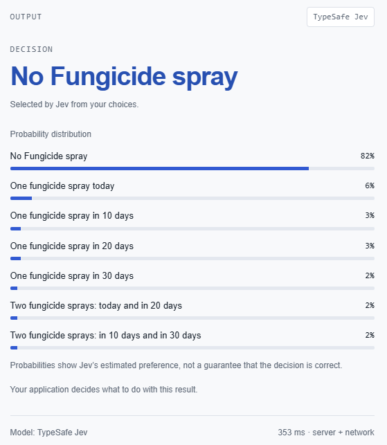

AI large language models are disrupting all parts of our lives at break neck 
pace and I am faced with the question: **Are AI decision support models about to replace epidemiological models?**  

As a scientist who specialises in pest and disease modelling I am intrigued with
how AI decision models like [Jev](https://typesafe.ai/blog/introducing-system-one-models-and-jev)
a class of AI model call 'system one'.  
System one AI models are named after the concept 
["Thinking Fast and Thinking slow"](https://www.penguin.com.au/books/thinking-fast-and-slow-9780141033570),
where system one indicates fast thinking: automatic cognician, intuitive. 
Compared with thinking slow: deliberative, careful thought, highly reasoned.  

> So are AI decision models useful for making management decisions in agriculture?  

The recent access to the [Jev playground](https://jevplayground.com/) allowed me
to evaluate this exact question.

I decided to test it's ability by presenting the model with a scenario which 
could be faced by a vineyard manager observing downy mildew for the first time
in thier orchard. 
The farm manager is posed with the consideration should they apply a fungicide 
application and when should they apply the fungicide spray for maximum efficacy.  

In the 2023-24 growing season I undertook an experiment on downy mildew () on a
vineyard on Mt. Tamborine in Queensland Australia.
With this work I was evaluating the performance of the a mechanistic epidemiological
model which I translated from the academic literature into R, [`viticolR`](https://github.com/PaulMelloy/viticolR).
Dissecting this model gave me insight into the risk factors leading to problematic
downy mildew epidemics.  

Downy mildew (*Plasmopara viticola*) is an oomycete, which can over-winter in 
leaf litter from infected leaves from previous seasons. 
The contaminated leaf litter material contains oospores which, with suitable 
temperature and moisture conditions promote germination and macrosporangiums
which are triggered to release zoospores through rainsplash. 
Oospores are the most likely source of primary infections in vineyards.  

Once the disease infects leaves in the canopy secondary infection can spread. 
Secondary infection spreads much faster compared to primary infection events,
especially during warm weather and rainfall events.
Infected leaves die prematurely reducing the plant productivity. 
Once the disease establishes in the vineyard the farm can suffer significant 
yield losses not only from damage to the leaves, but also infection of the grapes.  

The ideal management strategy is to protect the crop with a fungicide spray ahead
of any potential dispersal events and prior to bunch closure. 
This requires constant vigilance with an eye on weather forecasts and any potential
primary infections.
Most farms will apply mixtures of strobilurin and demethylase inhibitor (DMIs)
fungicides (fungicide groups 3/11 or 7) early in the season to protect from 
infections. 
These fungicides can provide 2 - 4 weeks of protection and can rarely be applied 
after later in berry development.  

With this knowledge under our belt lets see how Jev will perform.

I will summarise my prompts below, however you can obtain my full prompts on the
following page if you wish to recreate my evaluations.

   
   

## Inputs always included:  
### **State**: context for the model  

> It is the 1st of November, A vineyard grower in Stanthorpe in Australia notices 
one plant in their vineyard shows signs of downy mildew. 
Downy mildew, caused by the oomycete Plasmopara viticola, is a major disease of 
grapevines that infects leaves, shoots, flowers and developing berries, 
particularly under warm, wet conditions. 
Infected leaves develop characteristic yellow “oil spots” that can progress to 
tissue death and premature leaf fall, while infection of flowers and young 
berries can cause browning, shrivelling and loss of fruit. 
Severe disease can substantially reduce grape yield and quality and, through 
extensive defoliation, reduce vine vigour and carbohydrate reserves needed for 
growth and production in subsequent seasons.

### Question  
> Which fungicide spray strategy should he undertake?  

### Decision type  
> Choice  

### Standard choices  

>  1. No fungicide spray  
  2. One fungicide spray today  
  3. One fungicide spray in 10 days  
  4. One fungicide spray in 20 days  
  5. One fungicide spray in 30 days  
  6. Two fungicide sprays: today and in 20 days  
  7. Two fungicide sprays: in 10 days and in 30 days  

   

***  

## Scenario One  
### Additional input: **State**  

> The last fungicide application was metalaxyl 14 days ago.  
The remainder of the season is forecast to be wetter and warmer than average.  

### Output  

{style="float: center" width=50%}  

### Interpretation  

The output gives Jev's confidence in each of the choices being the correct choice.  

Here we see that the model does a good job of making a decision.  

A fungicide spray at the earliest convenience is the best option ahead of wet
conditions to limit the spread of the disease. 
Considering a follow-up spray in 20 days is also an option worth considering.  

*I am suddenly a bit nervous ...*

   

***  

## Scenario Two  
### Additional input: **State**  

> The last fungicide application was metalaxyl **7 days ago**.  
The remainder of the season is forecast to be drier and cooler than than average.  

### Output  

{style="float: center" width=50%}  

### Interpretation  

The model does not provide ideal recommendations here.  

The fungicide 7 days ago is still likely to be providing protection and with
cool dry conditions in the future, the farm manager is best delaying thier 
fungicide spray.  

*No longer questioning my career choices ...*

   

***  

## Scenario Three  
### Additional input: **State**  

> The last fungicide application was metalaxyl **7 days ago**.  
There is no rain and dry conditions forecast over the next 30 days.  

### Output  

{style="float: center" width=50%}  

### Interpretation  

While no Fungicide is increasing in confidence, immediate fungicide application
is still the most confident response

Despite downy mildew being present in the canopy, this is not a good recommendation.
The most risk averse farm manager may consider an single application in 20 -30 
days, but not immediately.  

*Hold my beer Jev!*  

   

***  

## Scenario Four  
### Additional input: **State**  

> Edited: It is November 1st, a vineyard grower in Stanthorpe in Australia has no 
history of Downy Mildew and has not yet observed any Downy mildew in his vineyard.  
The last fungicide application was metalaxyl **7 days ago**.  
There is no rain and dry conditions forecast over the next 30 days.  

### Output  

{style="float: center" width=50%}  

### Interpretation  

A good response. Finally the decision model does not recommend a fungicide 
application. 
This scenario makes it very clear that there is little to no concern for the
disease and the model is able to provide the correct response, not to spray.

*There maybe some home for you yet Jev*  

***  

## Final thoughts  

Models like `Jev` are very new and the whole pace of change in AI development
is dizzingly fast.
While the model in it's current form is not capable of providing reasonable 
decision support for agriculture, there is potential to use this approach in
future research and development.

While Jev remains closed source, some open weight system one decision models such
as [Tev1](https://www.together.ai/models/tev1-4b-experimental) have been 
released to the publically. 
So who knows when we might be able to fine-tune these models to provide better
decision support for integrated pest management.  
